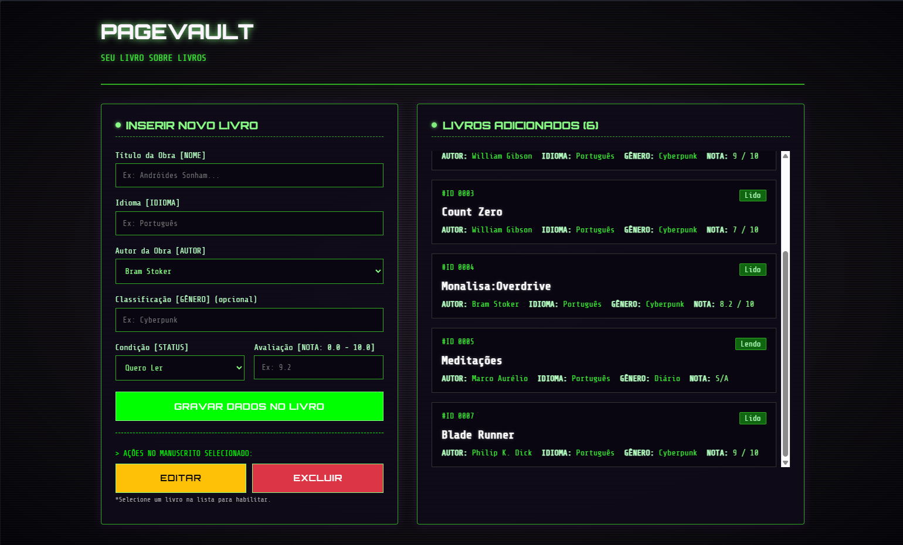

# 📚 PageVault

> **Seu livro sobre livros.** Uma aplicação web full-stack para gerenciar sua biblioteca pessoal com uma interface inspirada em terminais CLI.




## 📖 Visão Geral

O **PageVault** é um catálogo pessoal de livros que permite ao usuário cadastrar, organizar, acompanhar o progresso de leitura e avaliar suas obras.

O projeto foi construído do zero com a ideia de praticar conhecimentos em REACT, MySQL, ASP.NET e etc.

## 🛠️ Arquitetura e Tecnologias

*   **Frontend:** React.js + Vite
*   **Backend:** C# + ASP.NET Core Web API
*   **Banco de Dados:** MySQL
*   **Estilização:** CSS puro

## ✨ Funcionalidades (CRUD Completo)

### 📕 Livros
*   **Listagem:** Exibe todos os livros cadastrados com seus respectivos autores.
*   **Cadastro:** Permite inserir Título, Idioma, Gênero (opcional), Status (Quero Ler, Lendo, Lido, Abandonado) e Nota (0.0 a 10.0, opcional).
*   **Edição:** Permite alterar qualquer informação de um livro existente.
*   **Exclusão:** Remove o livro do banco de dados com confirmação.

### ✍️ Autores
*   **Relacionamento 1:N:** Um autor pode possuir vários livros.
*   **Seleção:** No formulário de cadastro de livro, o usuário escolhe o autor em um dropdown.
*   **Cadastro Rápido:** É possível criar um novo autor diretamente na tela de cadastro de livros, sem precisar mudar de página.

## 🗄️ Modelo de Dados

O banco de dados `vault` foi estruturado da seguinte forma:

**Tabela `autores`**
*   `Id` (int, PK, Auto-incremento)
*   `Nome` (varchar(100), UNIQUE, Obrigatório)

**Tabela `livros`**
*   `Id` (int, PK, Auto-incremento)
*   `Nome` (varchar(100), Obrigatório)
*   `Idioma` (varchar(100), Obrigatório)
*   `Genero` (varchar(50), Opcional)
*   `Status` (enum: 'Quero Ler', 'Lendo', 'Lido', 'Abandonado')
*   `Nota` (decimal(3,1), Opcional)
*   `AutorId` (int, FK -> autores.Id)

### Pré-requisitos
*   [.NET SDK 10.0+]
*   [Node.js (v18+)]
*   [XAMPP]

### Passo a Passo

1.  **Banco de Dados:**
    *   Abra o phpMyAdmin, crie um banco de dados chamado `vault` e importe o arquivo `schema.sql` presente na raiz do projeto.

2.  **Backend (API):**
    ```bash
    cd PageVault.Api
    dotnet restore
    dotnet run

2.  **Frontend (React):**
    cd pagevault-web
    npm install
    npm run dev
